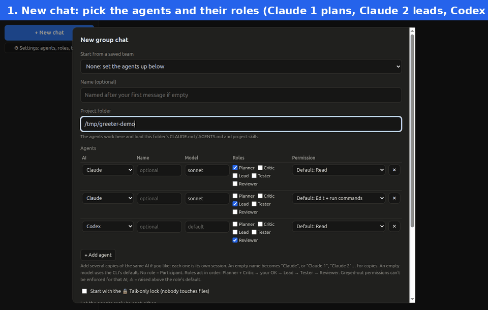

# agent-groupchat

[](https://github.com/MohammedAtya/agent-groupchat/actions/workflows/tests.yml)

**A group chat between you and your AI agents, running on your own computer.** Bring the AIs you
already have (Claude Code, Codex, Gemini CLI, Aider, or any OpenAI-compatible chat API), run
several copies of the same one, and give each a **role** with **permissions its CLI really
enforces**.

<!-- demo GIF goes here:  -->

- **Any mix of agents**: e.g. *Claude 1* (Opus) leads, *Claude 2* (a cheaper model) tests,
  *Codex* reviews, and a local *Llama* via Ollama gives a second opinion.
- **Roles that act in order**: Planner + Critic → ⏸️ your OK → Lead → Tester → Reviewer, with
  automatic fix rounds when the Tester or Reviewer finds problems.
- **Real permissions, never quietly loosened**: *Talk only*, *Read*, *Edit files*,
  *Edit + run commands* (sandboxed to the project folder) or *Auto*. Each agent's level maps to
  its CLI's own permission flags, and a level an AI can't enforce is greyed out.
- **Real sessions**: every agent is a real CLI session in your project folder, so CLAUDE.md /
  AGENTS.md, skills, hooks and MCP servers work as usual, and you can continue any session from
  a terminal.
- **Standard library only**: Python 3.10+, no dependencies. Runs on Linux, macOS and Windows.

## Install

```bash
pipx install agent-groupchat      # or: uvx agent-groupchat
agent-groupchat                   # opens http://127.0.0.1:8765 in your browser
```

You also need at least one AI: a CLI you're already logged into ([Claude Code](https://code.claude.com/docs/en/overview),
[Codex CLI](https://github.com/openai/codex), [Gemini CLI](https://github.com/google-gemini/gemini-cli),
[Aider](https://aider.chat)) or a chat API (see [Agents](#agents)).

From source: `git clone https://github.com/MohammedAtya/agent-groupchat && cd agent-groupchat && python3 -m agent_groupchat`.

Options: `--port 9000`, `--no-browser`, `--version`. If the port is taken it uses the next free
one; if agent-groupchat is already running, it just opens it. Stop it with Ctrl+C.

## Quick start

1. **+ New chat**: pick a project folder and the agents. For each one choose the AI, an optional
   name and model, its **roles** and (optionally) a different **permission**. Or start from a
   saved **Team**, and **💾 Save as team** to reuse a setup.
2. Write a message. The hint above the box says who will answer, e.g.
   `→ Claude 1 plans → ⏸️ your OK → Claude 2 works → Codex reviews`.
3. **@name** asks one agent directly: `@claude-2`, `@codex`; `@claude` reaches every Claude copy.
4. While they work you see what each one is doing (`✏️ editing app.py`, `$ pytest`). **■ Stop**
   ends the turn; **▸ Diff** under a reply shows exactly what it changed.

## Agents

| AI | What you need | Permission levels it can enforce |
|---|---|---|
| Claude Code | `claude`, logged in | all five |
| Codex CLI | `codex`, logged in | Talk*, Read, Edit + run commands, Auto |
| Gemini CLI | `gemini`, logged in | Talk, Read, Edit, Edit + run commands (needs Docker/Podman; Seatbelt on macOS) |
| Aider | `aider` + a model name (e.g. `sonnet`) | Talk*, Read, Edit |
| Chat API | an OpenAI-compatible endpoint | Talk only (it sees the chat, not your files) |

\* can't be stopped from reading files: it stays read-only and is told to only discuss.

**⚙ Settings → Agents** shows which CLIs are installed (with a **Test** button) and lets you add
chat APIs: OpenAI, Ollama, OpenRouter, Groq, LM Studio… They're saved in
`~/.agent-groupchat/config.json`:

```json
{"apis": [
  {"id": "llama", "name": "Llama", "base_url": "http://localhost:11434/v1", "model": "llama3.1"},
  {"id": "gpt", "name": "GPT", "base_url": "https://api.openai.com/v1", "model": "gpt-4.1",
   "key_env": "OPENAI_API_KEY"}
]}
```

`key_env` is the **name** of the environment variable holding the API key. The key itself is never
stored, and Settings refuses a value that looks like a key.

Aider runs with every prompt answered automatically, so everything risky it would agree to is
switched off: shell commands, git commits, `.gitignore` edits, self-updates. Its history files live
in `~/.agent-groupchat/sessions/`, not in your project.

## Roles and the order of turns

| Role | Job | Default permission |
|---|---|---|
| **Planner** | breaks the request into steps and asks questions before any work starts | Read |
| **Critic** | challenges the idea, looks for what everyone missed | Read |
| **Lead** | does the work | Edit + run commands |
| **Tester** | writes and runs tests; must not change the code under test | Edit + run commands |
| **Reviewer** | checks the Lead's changes, says what to fix or LGTM | Read |
| **Participant** | no special job (agents without a role) | Edit + run commands |

- A plain message runs the roles in order: **Planner + Critic → ⏸️ your OK → Lead → Tester →
  Reviewer**. Roles nobody holds are skipped; agents without a role answer directly.
- After the plan, the chat waits: press **▶ Go ahead**, or reply to change the plan.
- The Tester and Reviewer end with `VERDICT: LGTM` or `VERDICT: FIX`. On FIX the Lead fixes it
  automatically (0–3 rounds, default 1), then it comes back to you.
- An agent can hold several roles (it gets the highest default); several agents can share a role.
  The same agent can't be Lead *and* Reviewer of its own work (two copies of one AI can).
- **⚙ Settings → Roles**: copy a built-in role or write your own (name, job, default permission).

## Permissions

| Permission | Claude Code | Codex | Gemini CLI | Aider | Chat API |
|---|---|---|---|---|---|
| Talk only | no tools at all | read-only sandbox, told to only discuss | every tool denied | ask mode, told to only discuss | ✓ |
| Read | read/search tools, `git diff/log/status`, tests (in the sandbox) | read-only sandbox | read/search tools | ask mode | – |
| Edit files | edit tools in the folder, **no** commands | – | `auto_edit`: edits, no shell | code mode, no shell, no commits | – |
| Edit + run commands | edits + commands, sandboxed to the folder | `workspace-write` sandbox | `yolo` inside Gemini's sandbox | – | – |
| Auto | auto mode: a classifier blocks risky actions | "approve for me": an automatic reviewer | – | – | – |

- Under **Team** you can raise or lower any agent's permission; ⚠ marks a raised one, and Auto
  asks you to confirm.
- **🔒 Lock** drops every agent to *Talk only* at once, and unlocking restores them.
- Agents that can edit take turns (one at a time); read-only agents work in parallel.
- After every reply the folder is compared before and after: a read-only agent that changed files,
  or a Tester that changed non-test code, gets a ⚠ under its reply.

## Safety

- **It acts on your files.** *Edit* and *Edit + run commands* let agents change your project.
  Use git, and start with the 🔒 Lock or read-only roles if you're unsure.
- **Auto** lets an agent decide on its own (risky actions are blocked by Claude Code's classifier
  or Codex's reviewer). Use it in folders you can afford to have changed.
- **Sandboxes**: commands are confined to the project folder by the agents' own sandboxes. If a
  sandbox isn't available, the affected levels drop down (the agent's chip says *(limited)*);
  they never run unconfined.
- **More agents = more cost.** Every agent reads the chat on each turn. **Compact** summarizes a
  long chat so fresh sessions continue from the summary.
- **Local only**: the server listens on 127.0.0.1, and only its own page can drive it (Host and
  Origin checks plus a token that's new on every launch). Your chats stay in
  `~/.agent-groupchat/`; nothing is sent anywhere except to the AIs you chose.

## Platforms

| OS | What works |
|---|---|
| Linux | Everything. Commands run in a bubblewrap sandbox (see below). |
| macOS | Everything. Claude Code and Codex use the built-in macOS sandbox. |
| Windows, in WSL | Everything (it's Linux). |
| Windows, native | Talk, Read and Edit. Commands and Auto need a sandbox the agents don't have on native Windows, so they're greyed out and the page suggests WSL. |

### Enable the sandbox (Linux)

Claude Code and Codex confine commands with `bubblewrap`. Install it if it's missing
(`sudo apt install bubblewrap`, `sudo dnf install bubblewrap`, …). On **Ubuntu 23.10+ / 24.04**
AppArmor also blocks it (`bwrap: setting up uid map: Permission denied`). The one-time fix:

```bash
sudo tee /etc/apparmor.d/bwrap >/dev/null <<'EOF'
abi <abi/4.0>,
include <tunables/global>

profile bwrap /usr/bin/bwrap flags=(unconfined) {
  userns,
  include if exists <local/bwrap>
}
EOF
sudo apparmor_parser -r /etc/apparmor.d/bwrap
bwrap --ro-bind / / true && echo "sandbox OK"
```

This lets `bwrap` (and only `bwrap`) create user namespaces again, which is the setup Ubuntu
documents for sandboxing tools. The page notices within about a minute.

## More features

- **Discussion rounds**: after they all answer, agents can reply to each other for 1–3 rounds
  (each stays quiet if it has nothing to add). **Hand-offs**: an agent that addresses another
  (`@codex …`, `Claude 2, can you …`) gets an answer from it.
- **Skills**: type `/` for the skills your agents have; a skill runs on the agents that have it.
- **Live preview, reply stats** (time, ≈ cost, tokens, files changed), **↻ Retry** for failed
  replies, **↩ Reply** to one agent, **Markdown** with Copy buttons, **Export** as Markdown.
- **Continue in a terminal**: the bottom of each chat shows `claude -r <id>`, `codex resume <id>`
  or `gemini --resume <id>` for every agent.
- **Old chats**: if you used the earlier single-folder version (`~/groupchat`), the page offers
  to import copies of its chats once.

## Your data

Everything lives in `~/.agent-groupchat/` (set `AGENT_GROUPCHAT_HOME` to move it): `chats/`,
`sessions/` (chat-API and Aider history), `logs/` and `config.json` (chat APIs, your roles,
teams). Deleting a chat on the page doesn't delete the agents' own sessions.

## Development

```bash
python3 -m unittest discover -s tests -t .    # ~140 tests, ~10 s, no AI calls
python3 -m agent_groupchat --no-browser       # run from the source folder
```

The tests use a fake agent CLI (`tests/bin/fake_agent.py`) that speaks each real CLI's output
format, so they cost nothing. GitHub Actions runs them on Linux, macOS and Windows (Python 3.10 and
3.13) and installs the package with pipx on all three on every push.

Layout: `agent_groupchat/server.py` (chat engine + web server), `roles.py`, `config.py`,
`platform_support.py`, `adapters/` (one file per AI: `claude.py`, `codex.py`, `gemini.py`,
`aider.py`, `openai_api.py`), `static/index.html` (the page). Adding an AI means writing one
adapter (see `adapters/base.py`). The design is in [SPEC.md](https://github.com/MohammedAtya/agent-groupchat/blob/main/SPEC.md).

## Credits

Works well with [Matt Pocock's skills](https://github.com/mattpocock/skills) (`/grill-me`,
`/tdd`, …): install them for your agents and type `/` in the chat.

## License

[MIT](https://github.com/MohammedAtya/agent-groupchat/blob/main/LICENSE)
